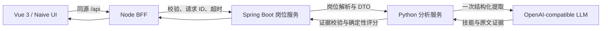

# CareerLens · 看清经历与岗位的连接

面向高校学生的简历与岗位分析工作台。粘贴简历，选择开发岗位或输入自己的 JD，得到可追溯的技能证据、能力缺口、简历问题和可复算的覆盖分数。

> 每个命中都回到原文，每个分数都有计算依据。未命中表示「简历未体现」，不等于「不具备能力」。

## 快速启动

需要 Docker Engine 与 Docker Compose。脚本同时支持 `docker compose` 和 `docker-compose`，无需在宿主机安装 Java、Python 或 Node。

```bash
cp .env.example .env
# 编辑 .env，只填写自己的 LLM_API_KEY；默认使用 DeepSeek。
scripts/compose.sh up -d --build --wait
```

打开 http://localhost:8080。默认仅绑定本机回环地址。内部三个服务不暴露宿主机端口。

如果本机无法直连 Docker Hub，可显式指定可访问的镜像前缀，例如本次验证使用：

```bash
CAREERLENS_MIRROR=docker.m.daocloud.io/library scripts/compose.sh up -d --build --wait
```

镜像源是本地网络选项；CI 默认使用官方镜像。首次构建需要下载 Maven/npm/Python 依赖，后续构建复用缓存。

### 模型配置

| 变量 | 默认/说明 |
| --- | --- |
| `LLM_BASE_URL` | `https://api.deepseek.com`；代码在其后追加 `/chat/completions` |
| `LLM_MODEL` | `deepseek-flash` |
| `LLM_API_KEY` | 必填，仅注入 Python 服务；不提交到 Git |
| `LLM_MODE` | `live`；只有显式测试覆盖配置才使用 `test` |
| `WEB_PORT` | `8080` |

也可配置其他支持 Chat Completions JSON Output 的 OpenAI-compatible 服务。DeepSeek 官方域名会显式关闭 thinking，以控制响应预算。真实调用失败会显示错误，不会悄悄返回测试结果。

## 不用密钥的测试环境

测试桩是一个独立 HTTP 服务，业务请求仍经过 BFF、Java 和 Python。页面会明确标注「测试模式结果」。它验证协议与流程，不代表真实模型能力。

```bash
WEB_PORT=8082 scripts/compose.sh -p careerlens-test -f compose.yml -f infra/compose.test.yml build
WEB_PORT=8082 scripts/compose.sh -p careerlens-test -f compose.yml -f infra/compose.test.yml up -d --no-build --wait
python3 scripts/smoke.py --url http://localhost:8082 --analyze
# 完成后，仅停止本项目测试环境
scripts/compose.sh -p careerlens-test -f compose.yml -f infra/compose.test.yml down
```

网络受限时，在 build 命令前同样设置 `CAREERLENS_MIRROR`。

## 架构与职责



- **Web**：Vue 3 + TypeScript + Vite + Naive UI；Nginx 提供静态文件和同源代理。
- **BFF**：Node 24 + Fastify 5；输入限制、请求 ID、超时和错误映射。
- **Java**：Java 21 + Spring Boot 3.5；岗位目录、解析和强类型分析契约。
- **Python**：Python 3.12 + FastAPI + Pydantic + HTTPX；清洗、LLM 提取、证据校验、技能归一化、评分。

API 细节见 [contracts/API.md](contracts/API.md)。完整简历不写入数据库或服务日志；本项目不包含数据库、账号、历史记录、上传或 OCR。

### 评分

`round(100 × 命中技能权重 / 全部可验证岗位技能权重)`

必备技能权重 3，加分技能权重 1，同一技能去重，必备优先。每项技能都必须有来源文本中的连续证据，且证据包含技能或显式别名。没有可评分要求返回 422，绝不生成凭空分数。该分数只表示技术技能的简历证据覆盖度，不包含学历、年限、软技能，也不是录用概率。

## 开发与测试

各服务独立管理依赖，锁文件均已提交。宿主机开发需要 Node 24、Java 21/Maven 和 Python 3.12。

```bash
# Web
cd apps/web
npm ci
npm run typecheck
npm test
npm run build
# BFF：在 apps/bff 内执行同样四条命令
# Java：在仓库根目录
mvn -B -f services/jobs/pom.xml verify
# Python：先建立并激活 Python 3.12 虚拟环境
cd services/analyzer
pip install -r requirements.lock -r requirements-dev.txt
ruff check .
pytest -q
```

启动测试 Compose 后，在 `apps/web` 运行浏览器验收：

```bash
npx playwright install chromium
PLAYWRIGHT_BASE_URL=http://localhost:8082 npm run e2e
# 使用本机已安装 Chrome 时可额外设置 PLAYWRIGHT_CHANNEL=chrome
```

`career-lens.spec.ts` 不拦截 API，执行完整链路。`mock-ui.spec.ts` 使用固定数据检查桌面/移动展示。CI 在 Ubuntu 上执行单元测试、构建、Compose 与浏览器验收。

## Git、发布与回滚

通过 `feat/career-lens` → PR → `main` 保留提交历史。PR 运行验证；`main` 验证通过后，发布四个服务的 linux/amd64 与 linux/arm64 镜像，标签为完整 commit SHA：

`ghcr.io/leongwind/jsxq-test-{web,bff,jobs,analyzer}:<commit-sha>`

部署或回滚都指定一个固定版本：

```bash
scripts/deploy.sh <目标commit-sha>
# 对已在本机按 SHA 构建/标记的镜像：
scripts/deploy.sh <目标commit-sha> --local
```

GHCR 包的可见性由仓库/包权限控制；若包为私有，拉取前需要有 read:packages 权限的登录。源代码 Compose 构建不依赖 GHCR 登录。部署脚本等待各服务健康并检查岗位 API；真实模型验收可再运行 `python3 scripts/smoke.py --analyze`。没有数据库迁移，回滚不涉及用户数据。

## 交付材料

- [DELIVERY.md](DELIVERY.md)：实际验证记录、部署回滚证据与已知限制。
- [AI_LOG.md](AI_LOG.md)：AI 协作记录及可见会话导出。
- [docs/DEFENSE.md](docs/DEFENSE.md)：15 分钟答辩提纲。
- [docs/SOURCES.md](docs/SOURCES.md)：简历、真实 JD 与模型来源。
- [docs/TIMEBOX.md](docs/TIMEBOX.md)：计时起止。
